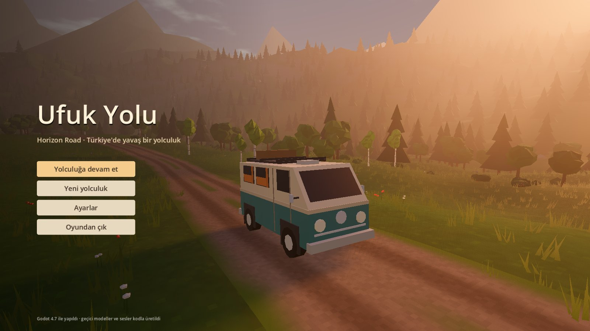

# Ufuk Yolu / Horizon Road

Türkiye'de karavanla, acele etmeden yapılan bir yolculuk. Stilize low-poly 3D,
Godot 4.7 (GDScript). Savaş yok, zaman baskısı yok, "game over" yok.



## Oynamak

- **Windows:** `build/dist/HorizonRoad-Windows-x86_64.zip` dosyasını aç ve `HorizonRoad.exe`'yi çalıştır
  (build klasörü depoya girmez; aşağıdaki "Build" adımlarıyla üretilir).
- **Editörden:** Godot 4.7 ile `project.godot`'u aç, F5.

## Kontroller (klavye + fare, gamepad destekli)

| Tuş | İş |
|---|---|
| WASD | Sür / yürü |
| Fare | Etrafa bak |
| E | Araçtan in-bin, konuş, kullan |
| C | Kamera görünümü (arka / kokpit) |
| L | Farlar |
| F | Fotoğraf makinesi |
| B | Çizim defteri |
| J | Günlük (albüm, koleksiyon, çizimler, insanlar) |
| M | Harita / bölgeler arası seyahat |
| F5 / F9 | Hızlı kayıt / yükleme |
| Esc | Duraklat, ayarlar |

Tuşlar Ayarlar → Kontroller'den değiştirilebilir.

## Neler var

- Dört bölge: **Karadeniz Yaylası** (çay bahçesi, göl, yayla köyü), **Ege Balıkçı Köyü**
  (koy, iskele, zeytinlikler), **Kapadokya Vadileri** (peri bacaları, tüf yamaçlar, şafakta
  balonlar, bağlar) ve **Doğu Anadolu Yaylası** (Ağrı Dağı, dağ gölü, göçer çadırları, sürüler).
  Yol tabelasından ya da karavandaki harita masasından seyahat.
- Gün-gece döngüsü, 6 hava durumu, mevsimler (Karadeniz kışı karlı).
- Fotoğraf modu (diyafram, pozlama, filtre, puanlama, koleksiyon) ve çizim modu.
- Esnaflar ve işler: Fadime (çay hasadı, çay demleme), Recep (yükseltmeler, traktör ayarı),
  Hasan Reis (ağ çekme, ağ onarma), Zeynep Usta (Avanos çömlekçiliği), Ferhat Amca (sürüyü
  ağıla toplama). İkinci işler dostluk ilerleyince açılır.
- **Gezici kafe:** Recep'ten kafe setini al, karavanı park et, arka kapıda kafeyi aç
  ([E]), gelen yerlilere bölgenin menüsünden servis yap. Hızlı servis bahşiş getirir.
- Karavan yükseltmeleri ve iç mekân (uyku, çay, harita, günlük).
- TR / EN, otomatik kayıt, kodla üretilmiş müzik ve ortam sesleri.

## Geliştirme

```bash
# Testler (106 kontrol)
godot --headless --path . res://tests/test_runner.tscn

# Oyun akışlarını otomatik oynat (tüm seçenekler scripts/dev/dev_cli.gd başında)
godot --headless --path . -- --story
godot --headless --path . -- --money=400 --workshop
godot --headless --path . res://regions/aegean_village/aegean_village.tscn -- --fishing

# Ekran görüntüsü
godot --path . -- --hour=18.9 --weather=partly_cloudy --shot=out.png
```

## Build

Godot 4.7 export şablonları kurulu olmalı (Editor → Manage Export Templates).

```bash
godot --headless --path . --export-release "Windows Desktop" build/windows/HorizonRoad.exe
godot --headless --path . --export-release "Linux" build/linux/HorizonRoad.x86_64
```

## Belgeler

- `GDD.md` — tasarım belgesi
- `PLAN.md` — aşamalar, notlar ve bilinen sorunlar
- `ASSETS.md` — geçici (kodla üretilmiş) varlıklar ve önerilen CC0 paketler
- `docs/screenshots/` — her aşamanın ekran görüntüleri
